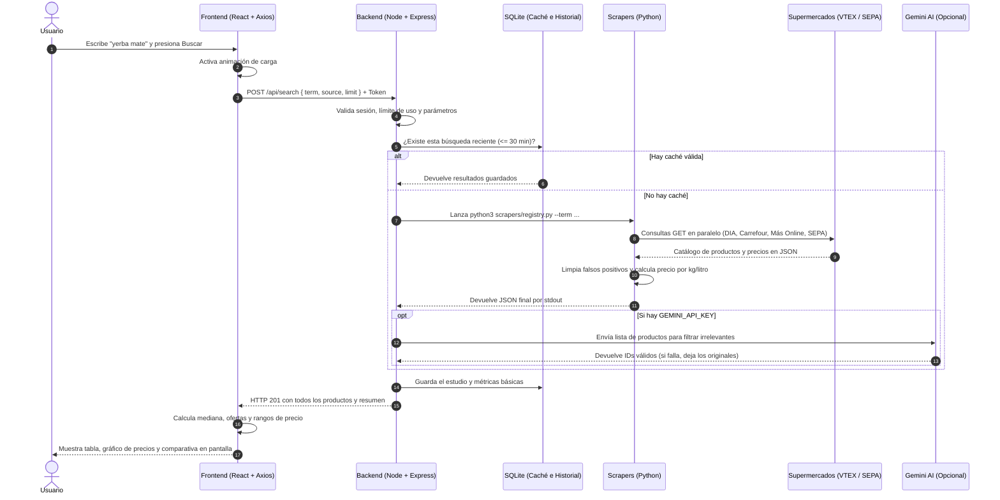
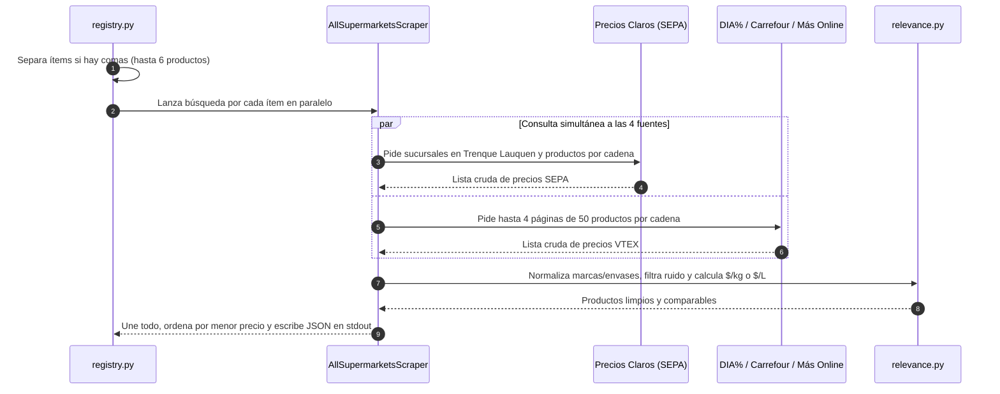

# Cómo funcionan los Scrapers en Radar Mercado

Este documento explica de forma clara y directa cómo viaja una búsqueda en **Radar Mercado**: desde que el usuario escribe un producto en pantalla hasta que los scrapers buscan los precios, los procesan y los resultados vuelven al navegador.

> **Dato clave:** Aunque los llamamos *scrapers*, en este proyecto Python **no lee páginas HTML**; consulta directamente las **APIs públicas en JSON** de los supermercados (VTEX y Precios Claros). Eso hace que la búsqueda sea mucho más rápida y estable.

## 1. Cómo se conecta cada tecnología

El proyecto une cuatro piezas principales que se comunican en cadena:

| Conexión | Cómo se comunican | Para qué sirve |
| :--- | :--- | :--- |
| **React (Frontend) → Express (Backend)** | Petición HTTP `POST /api/search` en JSON usando `axios` (en desarrollo pasa por el proxy de Vite `:4173` hacia el puerto `:3000`). | Envía lo que escribió el usuario, el supermercado elegido y el token de sesión. |
| **Express (Node.js) ↔ SQLite** | Lectura y escritura directa sobre el archivo local `radar-mercado.sqlite` (`better-sqlite3`), sin red de por medio. | Verifica si esa misma búsqueda ya se hizo en los últimos 30 minutos (caché) y guarda el historial. |
| **Node.js → Python (Scrapers)** | Ejecución de un proceso hijo (`child_process.spawn`). Node le pasa argumentos por consola y Python le devuelve un JSON por salida estándar (`stdout`). | Permite usar Python para recolectar datos en paralelo sin necesidad de levantar un segundo servidor web. |
| **Python → Supermercados (VTEX / SEPA)** | Peticiones HTTPS `GET` en paralelo usando hilos (`ThreadPoolExecutor`) y `requests`. | Trae los catálogos y precios reales de DIA%, Carrefour, Más Online y Precios Claros. |
| **Node.js → Gemini AI (opcional)** | Llamada HTTPS mediante el SDK `@google/genai` (solo si existe `GEMINI_API_KEY`). | Hace una limpieza final para quitar productos que no coinciden con lo que pidió el usuario. |
| **Express → React (Pantalla)** | Respuesta HTTP `201` con el JSON completo del estudio. | React calcula estadísticas rápidas en el navegador y dibuja la tabla, el gráfico y el changuito. |

## 2. Diagrama de secuencia: viaje completo de una búsqueda

## 3. Diagrama de secuencia: qué pasa adentro de Python

Cuando el usuario elige **Todos los supermercados** o escribe una **lista separada por comas** (ej. `"aceite, arroz"`), Python usa grupos de hilos (`ThreadPoolExecutor`) para consultar varias fuentes al mismo tiempo y reducir el tiempo de espera:

## 4. El recorrido paso a paso

1. **Captura en el Frontend (`SearchPanel.jsx` y `App.jsx`)**: cuando el usuario envía la búsqueda, React valida que tenga al menos 2 caracteres, muestra el carrito animado de espera y dispara `POST /api/search` mediante `axios` (`src/services/http.js`, con timeout de 125 segundos).
2. **Validación y Caché en el Backend (`server/routes/search.routes.js`)**: Express comprueba el token de usuario, aplica el límite de búsquedas (máximo 8 cada 10 minutos) y revisa en SQLite (`studies`) si ya existe un resultado fresco de los últimos 30 minutos para ahorrar tiempo y consultas externas.
3. **Puente Node.js → Python (`server/scraperRunner.js`)**: si no hubo caché, Node ejecuta `python3 scrapers/registry.py` con `child_process.spawn`. Controla que no tarde más de 120 segundos ni supere 8 MB de salida, y convierte el texto recibido por `stdout` en un objeto JavaScript (`JSON.parse`).
4. **Extracción y limpieza en Python (`scrapers/`)**:
   - `registry.py` detecta si es un producto único o una lista de changuito (separada por comas) y elige el scraper correspondiente.
   - `vtex.py` consulta las APIs públicas de DIA%, Carrefour y Más Online en bloques de 50 productos, tomando siempre la mejor oferta disponible.
   - `preciosclaros.py` busca sucursales cercanas a Trenque Lauquen en SEPA, las agrupa por cadena y consulta sus precios en paralelo.
   - `relevance.py` elimina palabras vacías, descarta falsos positivos típicos (como *"atún en aceite"* si buscaste *"aceite"*), unifica marcas y calcula el precio por kilo o litro (`$/kg` o `$/L`).
5. **Filtro opcional con IA y guardado (`server/gemini.js` y `server/db.js`)**: si está configurada la clave de Gemini, el backend le pide a la IA una última verificación para quitar resultados fuera de tema (si falla, conserva la lista del scraper). Luego guarda el estudio en SQLite y responde `HTTP 201`.
6. **Cálculo visual y pantalla (`src/utils/marketStats.js` y componentes UI)**: al recibir el JSON, React calcula en el navegador la mediana, precios extremos (*outliers*), zona de buenos precios y 10 rangos para el histograma, y renderiza `BasketSummary` (changuito), `RefinementBar` (filtros de marca/envase), `MarketSummary`, `PriceHistogram` y `ProductTable`.

## 5. Archivos principales para ubicarse rápido

| Archivo | Rol en el flujo |
| :--- | :--- |
| `src/components/SearchPanel.jsx` y `src/App.jsx` | Reciben la búsqueda del usuario y muestran los resultados finales. |
| `src/services/http.js` y `vite.config.js` | Conectan el frontend con el backend (`/api/search`). |
| `server/routes/search.routes.js` | Valida el pedido, consulta la caché en SQLite y coordina el proceso. |
| `server/scraperRunner.js` | Ejecuta Python desde Node.js y recibe el JSON por `stdout`. |
| `scrapers/registry.py`, `vtex.py`, `preciosclaros.py`, `relevance.py` | Consultan las APIs de supermercados en paralelo y limpian los datos. |
| `src/utils/marketStats.js` | Calcula estadísticas y arma los datos para el gráfico y la tabla. |
